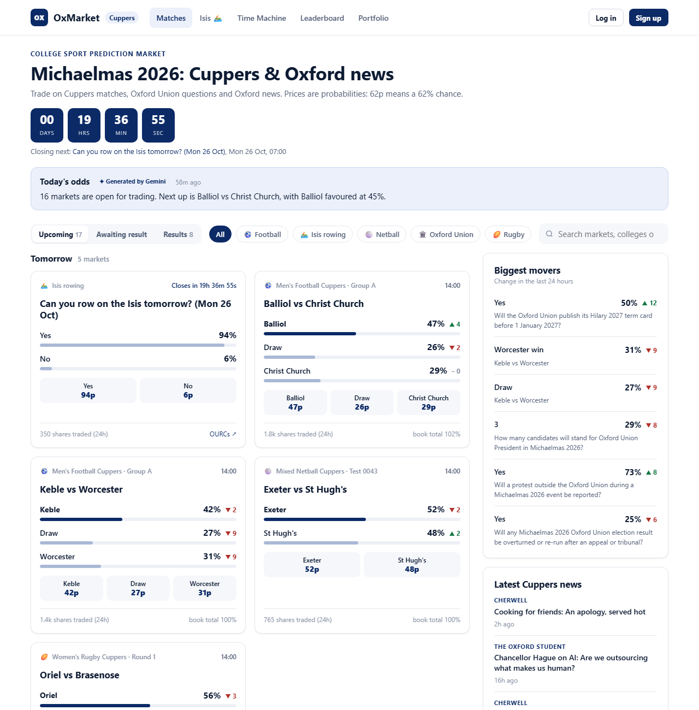
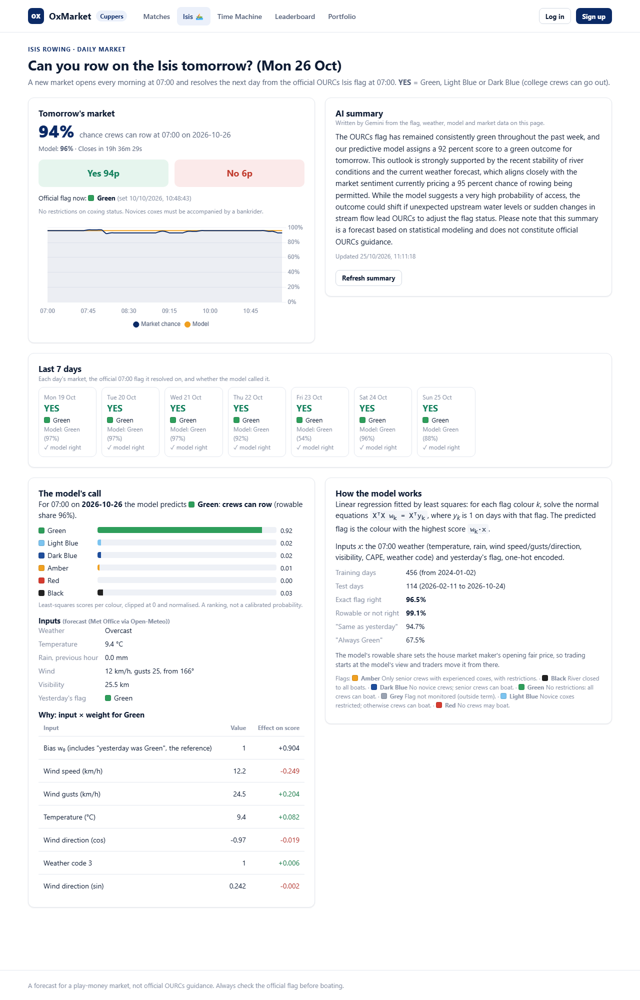
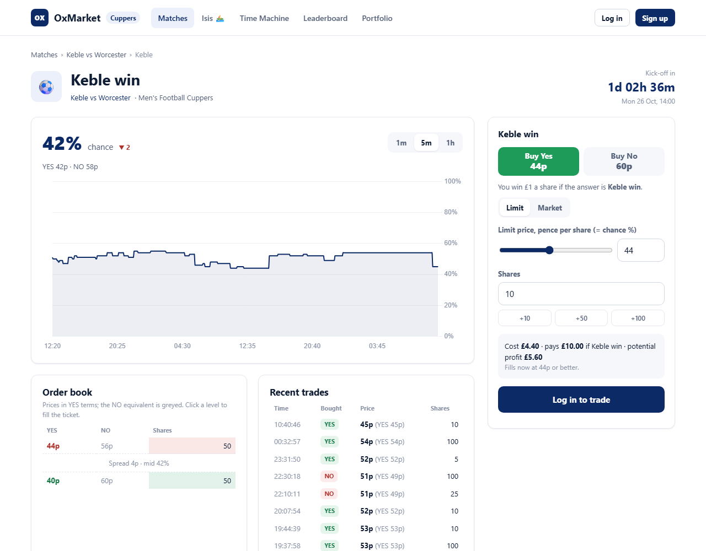
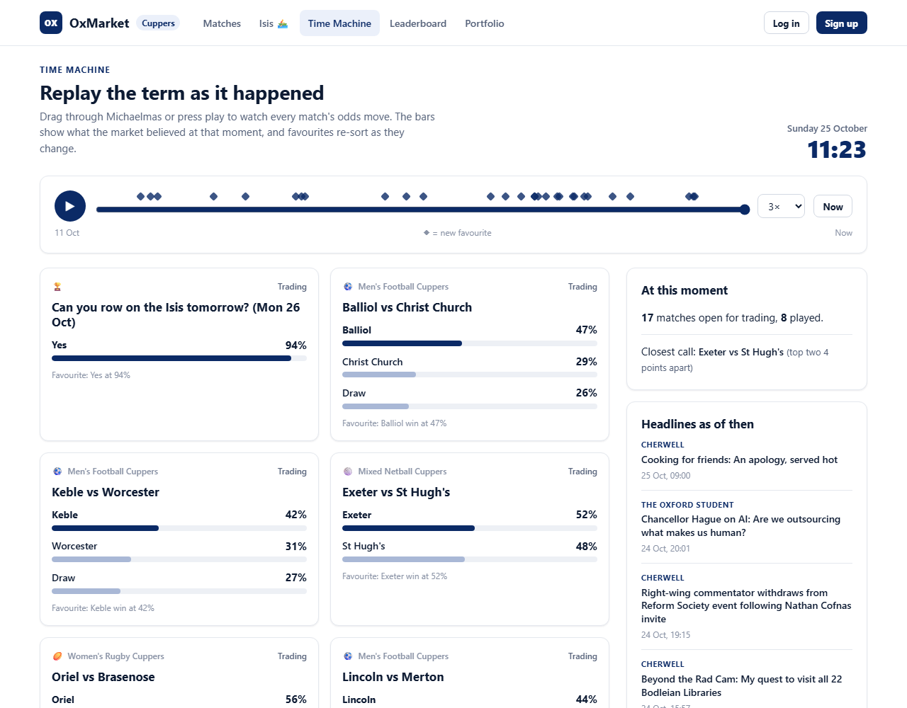

# OxMarket: trade on Oxford, watch the odds move through time

**A play-money prediction market for Oxford life, built at OxHack (theme: TIME).**
Bet on college Cuppers matches, Oxford Union drama, Oxford news, and, every single day,
*whether you'll be able to row on the Isis tomorrow*. Every outcome is a YES/NO market priced
in pence (62p = 62% chance). Sign up, get £1,000 of play money, and see who calls Oxford best.



## Why it's about TIME

- **Time Machine.** Drag a slider (or press play) to replay the term: every market's odds at any
  moment, favourites re-sorting as they change, and diamonds marking every lead change. It runs
  on as-of queries over a TimescaleDB price history.
- **Daily Isis market.** A new "Can you row on the Isis tomorrow?" market opens at 07:00 each
  day and settles the next morning from the official OURCs flag. It works like Polymarket's
  rolling Bitcoin up/down markets, but for Oxford rowing.
- **Live charts.** 1-minute, 5-minute and 1-hour candles come from continuous aggregates.
  Countdowns tick to every kick-off and close.
- **Hindsight.** The leaderboard shows how every trader's equity moved over time.

## Features

| | |
|---|---|
| **Real exchange** | A C++ limit order book (AVL tree of price levels, FIFO queues) matches every order. Limit and market orders, partial fills, cancels, collateral checks. NO is a view on the YES book. |
| **House market maker** | A bot quotes both sides of every market around a fair value, so there is always someone to trade with. |
| **Isis flag model** | A least-squares linear regression on 07:00 weather + yesterday's flag predicts the OURCs flag (96.5% on held-out days vs 94.7% for "same as yesterday"). Its call sets the market's opening price, and the page shows exactly why it made it. |
| **Gemini analysis** | Gemini writes the "why did the odds move" brief for each match, a daily digest, and a summary of the Isis market. It only sees the real data (flags, weather, model output, prices) and is told not to invent anything. |
| **Oxford news** | Cherwell and Oxford Student headlines are scraped automatically. Admins turn them into markets in one click. |
| **Admin portal** | Create Cuppers matches, yes/no and multiple-choice markets; approve drafts; post results to settle and pay out; edit reference data and live settings; full audit log. |

### The Isis market



- **Resolves** YES if the OURCs Isis flag at 07:00 is Green, Light Blue or Dark Blue (college
  crews can go out), and NO for Amber, Red, Black or Grey. The flag is read live from the OURCs API.
- **Model:** for each flag colour *k*, solve the normal equations `XᵀX w_k = Xᵀy_k` (one-vs-rest
  least squares, pure Python). The page shows the predicted flag, a score bar per colour, the
  inputs (tomorrow's Met Office 07:00 forecast via Open-Meteo, plus yesterday's flag), each
  input's push on the score, and test accuracy against simple baselines.
- **Fully automatic:** a background job settles yesterday's market and opens tomorrow's.

### Trading



### Time Machine



## Architecture

```
 browser (plain HTML/CSS/JS + Chart.js)
        │  JSON over /api
        ▼
 Flask app (server/app.py) ─── background jobs: market maker, price ticks,
        │                       auto-close, snapshots, news scraper, Gemini, Isis roll
        ├── C++ MarketServer.exe (book/OrderBook), one order book per market,
        │   driven over stdin/stdout. Pure-Python fallback if it isn't built.
        ├── TimescaleDB (Tiger Cloud), schema oxmarket
        │     hypertables: trades, price_ticks, portfolio_snapshots, admin_actions
        │     continuous aggregates: candles_5m, candles_1h · compression + retention
        └── Gemini (google-genai), OURCs flag API, Open-Meteo, Cherwell/Oxford Student RSS
```

- **The engine only matches; Postgres is the source of truth.** Each order is validated,
  risk-checked, matched in C++, and its fills are written in one DB transaction. If that fails,
  the engine restarts and replays every open order from the database.
- **TimescaleDB:** `time_bucket_gapfill` + `locf` give hole-free charts and sparklines;
  `first()`/`last()` build OHLC candles; as-of LATERAL lookups power the Time Machine;
  continuous aggregates keep candles cheap; tick chunks are compressed after a day.

## Run it

```bash
pip install -r server/requirements.txt
cp .env.example .env        # DATABASE_URL, SECRET_KEY, GEMINI_API_KEY (optional)
python server/seed.py       # starting Oxford Union markets (idempotent)
python server/app.py        # → http://localhost:5000
```

**Demo data** (run with the app stopped; both are idempotent):

```bash
python server/demo.py            # login demo / oxhack2026 (admin) + 14 days of price history
python server/isis.py --backfill # last 7 days of Isis markets, resolved from real flags
```

| `.env` | |
|---|---|
| `FAKE_AI=0` + `GEMINI_API_KEY` | real Gemini text (template text otherwise). The default model is `gemini-3.1-flash-lite`. |
| `AI_PROPOSALS=1` | let Gemini draft markets from scraped news (off by default) |
| `DISABLE_JOBS=1` | no background jobs (market maker, ticks, scraper, Isis roll) |
| `ADMIN_USERNAMES` | usernames that become admins when they register |

### Building the C++ engine (optional)

The app falls back to a pure-Python order book with the same protocol if the exe is missing.
With CLion's bundled toolchain, from Git Bash:

```bash
cd book/OrderBook
export PATH="/c/Program Files/JetBrains/CLion 2026.2.0.1/bin/mingw/bin:$PATH"
CM="/c/Program Files/JetBrains/CLion 2026.2.0.1/bin/cmake/win/x64/bin/cmake.exe"
"$CM" -S . -B build -G "MinGW Makefiles" -DCMAKE_BUILD_TYPE=Debug
"$CM" --build build -j 8 && ./build/OrderBookTests.exe
```

### Tests

```bash
python -m pytest server/tests -q   # 90+ tests, in-memory DB, against both engines
python -m pytest tests/db -v       # against the real database (tagged rows only)
```

Includes a randomised 300-order run checking that positions net to zero, no one's available cash
goes negative and the engine and database books agree, and an 8-client HTTP stress test with the
market maker running.

## Market mechanics

- **NO is a view on the YES book:** Buy NO @ p = Sell YES @ (100 − p).
- **Collateral:** an open buy locks price × qty, a short YES position locks 100 per share, and
  an open sell locks (100 − price) per share not covered by a long position. Orders that would
  make `cash − locked` negative are rejected before they reach the engine.
- **Market maker:** quotes 50 @ fair ± 2 every 10 s. Fair = the prior (Gemini or the Isis model)
  until the market trades, then an EMA of trades pulled toward the prior. Prices in a match are
  normalised to sum to 100, and quotes lean against the house's inventory.
- **Minimal C++ changes** to the original order book: lazy trader creation, a fill log from the
  four matching loops, depth collection for the BOOK command, resting-quantity lookup, and
  errors moved to stderr. The matching logic itself is unchanged.

## Repo map

| Path | What |
|---|---|
| `server/` | Flask app, trading layer, DB access, jobs, Gemini, Isis market, scraper |
| `book/OrderBook/` | C++ order book + `MarketServer` protocol wrapper |
| `web/` | the site: matches, market, Isis, Time Machine, leaderboard, portfolio, admin |
| `isis predictor/` | flag data, the linear regression (`model.py`) and an experimental neural-net forecaster |
| `plan/`, `DEVLOG.md` | how three parallel workstreams built this during the hackathon |

*Play money only. The Isis forecast is not official OURCs guidance; always check the flag before boating.*
